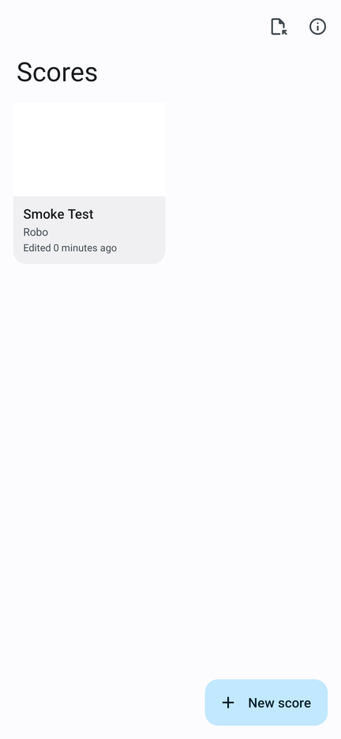
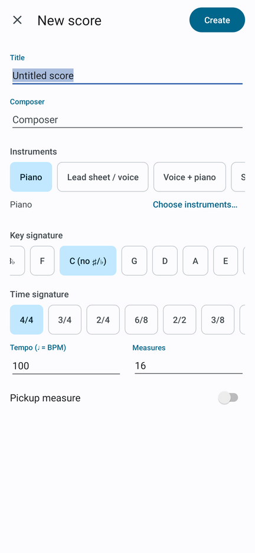
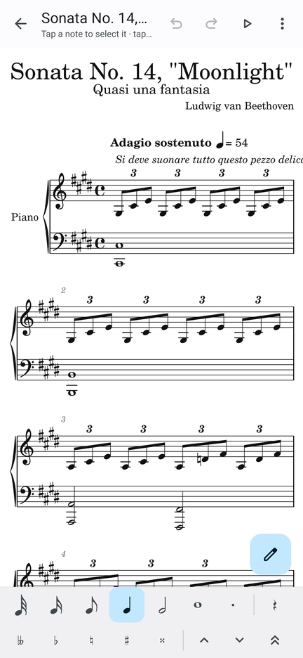
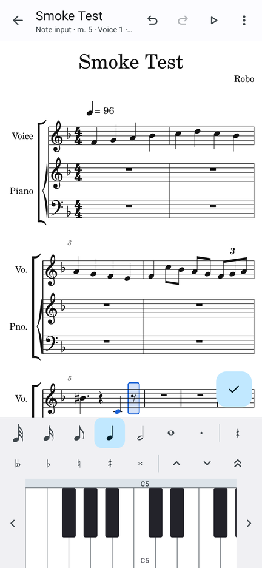
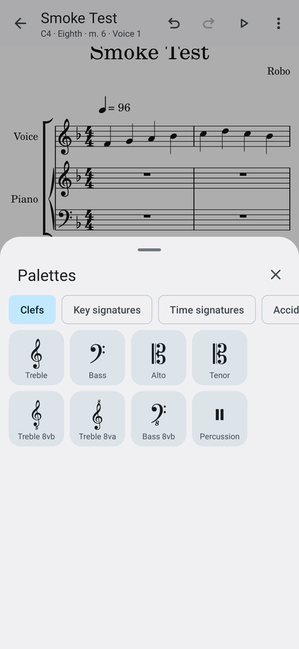

# Stave: a touch-first MuseScore port for Android

Stave is an Android music notation editor that ports the core of **MuseScore Studio** to phones and
tablets. It reads and writes MuseScore's own file format (`.mscz` / `.mscx`), uses MuseScore's
**Leland** music font and **Edwin** text font, and follows MuseScore's editing model: selection,
note input mode, palettes, voices, and MuseScore's keyboard shortcuts. The desktop interface was
redesigned for touch screens.

> **Download:** [`dist/stave-1.0.0.apk`](dist/stave-1.0.0.apk) (Android 7.0+, targets Android 15).
> Enable *Install unknown apps* for your browser or file manager, then open the APK.

*Unofficial project. "MuseScore" is a trademark of Muse Group, and this app is not affiliated
with or endorsed by Muse Group, so it ships under its own name.*

| Library | New score | Editor (imported .mscx) | Note input | Palettes |
|---|---|---|---|---|
|  |  |  |  |  |

*Screenshots come from the Robolectric UI tests, rendered with Android's real graphics stack on the JVM.*

## Why not a direct recompile of MuseScore?

MuseScore 4 is about a million lines of C++/Qt 6/QML. Building it for Android needs Qt for Android and
the Android NDK. Even with those, the result would be a desktop UI (menus, docked panels, mouse
hover, keyboard-first input) squeezed onto a 6-inch touchscreen. Stave reimplements the parts
musicians use day to day as a native Android app (Java, Android framework only, no third-party
libraries, about 550 KB). It stays file-compatible with MuseScore, so you can start a score on
your phone and finish it on the desktop, or the other way round.

## Features

| MuseScore (desktop) | Stave (Android) |
|---|---|
| Score files `.mscz`/`.mscx` (3.x–5.x) | Open and save. Writes MuseScore 4.20-format `.mscz` that MuseScore Studio opens directly |
| MusicXML import/export | `.musicxml`, `.xml`, `.mxl` import; MusicXML 4.0 export |
| Export PDF / MIDI | A4 PDF at MuseScore's default staff size; Standard MIDI File |
| Note input mode (`N`), durations, dots, rests, ties, triplets | Same, from a thumb-reachable bottom toolbar |
| Typing note names A–G | **On-screen piano keyboard** (multi-touch, scrollable octaves), plus tap-on-staff entry |
| Mouse note input with a shadow note | Touch the staff and a **ghost note follows your finger**. A **pitch bubble above the finger** names the note your finger is covering. Lift to enter |
| Voices 1–4 (blue/green/orange/purple) | Same colors; voice chips in the toolbar |
| Add to chord (Shift+letter) | "Add to chord" toggle |
| ↑/↓, Ctrl+↑/↓ transpose | Buttons, plus the same hardware-keyboard shortcuts |
| Palettes (clefs, keys, times, accidentals, articulations, dynamics, barlines, text) | **Bottom-sheet palette** with large 76 dp cells and category chips |
| Lyrics (type, Space → next syllable) | Lyrics dialog with a **Next** button / IME action that walks note by note |
| Chord symbols, staff text, tempo, rehearsal marks | Yes |
| Repeats, double/final/dashed barlines, pickup measure | Yes |
| Copy/paste, range selection (Shift+click) | Tap a measure, **long-press** to extend the range |
| Instruments panel | Add, remove and reorder instruments (40+ from MuseScore's instrument list) |
| Mixer, playback with cursor | Playback through Android's built-in General MIDI synth, follow-along highlighting, speed 50–200 %, per-part volume and mute |
| Page view | **Reflowed continuous view** that wraps to the screen width (no sideways scrolling), with pinch-to-zoom |
| New score wizard | One-screen form with templates (piano, SATB, string quartet, lead sheet …) and sensible defaults |

## Android usability and design choices

These choices follow Android and Material Design 3 guidance, plus established touch-notation
patterns (Soundslice's tablet piano mode, Sibelius for mobile):

* **Material 3**, including **Material You dynamic color** on Android 12+ (the UI picks up wallpaper
  colors) and a full **dark theme**. The score paper also goes dark.
* **48 dp minimum touch targets** everywhere. Palette cells are 76 dp. Taps on notes are matched with a
  "fat-finger" tolerance radius, so you don't need pixel precision.
* **Primary actions in the thumb zone:** a bottom toolbar, a bottom piano keyboard and a FAB toggle for note
  input. The top bar only holds undo/redo, play and the overflow menu.
* **Edge-to-edge** layout with correct system-bar and display-cutout insets, as Android 15 requires
  for apps targeting API 35.
* **Predictive back** (`OnBackInvokedCallback` on Android 13+). Back closes the palette, leaves
  note input and clears the selection before it exits.
* **Adaptive layout.** On wide screens (≥ 720 dp: tablets, foldables, landscape) the two toolbars
  merge into one row, the palette sheet is width-capped and the keyboard grows taller. The score
  re-flows to any width.
* **Haptic and audio feedback** on every note entry. A low-latency synth previews each pitch.
* **Hardware keyboards and Chromebooks** get MuseScore's shortcuts: `N`, `A–G`, `1–7`, `.`, `0`,
  `+`, arrows, `Ctrl+Z/Y/C/V/A/S`, `Space`, and more. See *⋮ → Keyboard shortcuts*.
* **Storage Access Framework** for import and export (no storage permission requested). The
  **share sheet** sends PDF, MusicXML, MIDI or `.mscz`, and Stave registers as an *Open with* target
  for MuseScore and MusicXML files.
* **Autosave.** Every edit is saved 1.5 s later and when the app goes to the background. The
  undo history keeps 80 steps.
* **Accessibility:** content descriptions and tooltips on all controls, state descriptions on toggles,
  TalkBack pitch announcements on the piano keyboard, and sp-based text.

## Building

The APK is built **without Gradle**, by `tools/build.sh` (aapt2 → javac → dx → zipalign →
apksigner). Ubuntu/Debian packages provide the tools, and the Android 14/15 platform files come
from Robolectric's `android-all` artifacts on Maven Central:

```sh
sudo apt install openjdk-21-jdk aapt zipalign apksigner dalvik-exchange
tools/build.sh                 # -> build/stave.apk (signed with keystore/debug.jks)
```

For a release key, set `STAVE_KEYSTORE`, `STAVE_KEYSTORE_PASS` and `STAVE_KEY_ALIAS`. The included
`keystore/debug.jks` (password `android`) is a public debug key. Don't use it for Play Store releases.

Android Studio users can open the project with the provided Gradle files instead (standard
`app/src/main` layout). Those files were not exercised in this repository's build environment.

## Tests

```sh
tools/test.sh [dir-with-.mscx-files]      # JVM tests: model, editing, file formats, playback
RENDER_DIR=/tmp/png tools/test.sh         # also renders engraving samples to PNG via Java2D
ROBO_LIB=/path/to/robolectric-jars tools/robolectric.sh   # UI smoke tests + screenshots
```

`tools/robolectric.sh` needs Robolectric 4.14 and its dependencies from Maven Central, plus
`androidx.test` *monitor* classes. Where Google's Maven repository is unreachable, compile those
classes from the Apache-2.0 sources in `github.com/android/android-test` (`runner/monitor`).

`tools/test.sh` also loads MuseScore's own engraving test corpus when you pass its directory
(`src/engraving/tests` in the MuseScore repository). It round-trips every file through the
`.mscx` writer and the MusicXML exporter.

## Source layout

```
app/src/main/java/io/github/vlesk/stave/
  model/    score model + editing engine (pure Java, unit-tested)
  edit/     EditorState: selection, note input, undo/redo (pure Java)
  engrave/  layout engine -> display list (beams, accidentals, ties, tuplets, systems)
  io/       .mscz/.mscx reader+writer, MusicXML reader+writer, score library
  audio/    playback timeline, MIDI writer, MediaPlayer playback, preview synth
  ui/       activities and custom views (score canvas, piano, palettes)
tools/      build.sh, test.sh, robolectric.sh, gen_glyphs.py
test/       JVM tests, Java2D renderer, Robolectric UI tests
```

## Known limitations

* Scores are shown and edited at concert pitch. Transposing-instrument display is not implemented yet.
* Not yet supported: slurs, hairpins, lines (8va, pedal), grace notes, cross-staff notation, tablature
  and multi-measure rests. Imported files keep their notes, but these elements are dropped, and
  the app lists what was simplified after import.
* Playback uses the platform's General MIDI synthesizer, not MuseScore's MuseSounds or SoundFonts.
* Mid-measure clef changes and nested tuplets are not supported.

## License

GPL-3.0, like MuseScore. The fonts (Leland, Edwin; © MuseScore Ltd) are under the SIL Open Font
License 1.1, with license files in `app/src/main/assets/fonts`. The Material Symbols icons are
Apache-2.0 (`third_party/MATERIAL-ICONS-LICENSE`). The instrument data comes from MuseScore's
`instruments.xml` (GPL-3.0).
